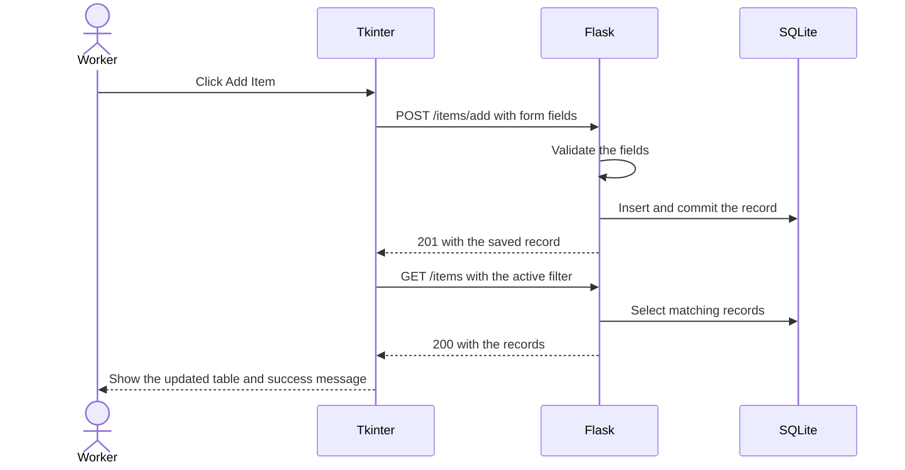

# Campus Lost & Found System Design

A campus desk worker operates the app. When a student asks about a missing item, the worker can look up found items by building. The app uses one Tkinter window, one Flask server, and one SQLite table. Building filtering is the extra feature for the course project.

## Tkinter window

```text
Campus Lost & Found                              [Lost-item illustration]
Staff desk at the Islamic University of Madinah

Item details
Item name               Found at                 Date found
[ Black umbrella    ]   [ Central Library   ▾ ]   [ 2026-11-19 ]

[ Add Item ]  [ Clear ]                                        [ Delete ]

Found items              Show building [ All buildings ▾ ]  [ Refresh ]

ID   Item name         Found at          Date found
7    Black umbrella    Central Library   2026-11-19

Item added successfully.
```

Tkinter uses a lavender-to-blue Canvas backdrop, a rounded panel around the form, and violet `ttk` controls. The transparent header illustration is bundled with the app. [Illustration](assets/lost-item-illustration.png)

- Selecting a row fills the form, shows its ID in the heading, and enables **Delete**. The blue primary button shows **Add Item** for a new record and **Save Changes** while editing. Enter submits that action from the item name or date field. **Delete** asks for confirmation, and **Clear** resets the form and selection.
- The form and filter share a list of buildings. Start with Central Library, University Restaurant, and the Faculty of Computer and Information Systems. **All buildings** is available in the filter.
- Applying a filter reloads the table. After a successful write, reload using the active filter. If it hides the saved record, the status still confirms the write and names the building.
- If changing the filter would hide a row with unsaved edits, ask before discarding the draft. For validation errors, place the message under the affected field and move keyboard focus there. [Jakob Nielsen’s usability heuristics](https://www.nngroup.com/articles/ten-usability-heuristics/)
- Show **No items found** inside the table for an empty result. Keep **Refresh** available after a connection error so the worker can retry from the same window.

The university’s campus map lists the Central Library and University Restaurant in the **المدينة الجامعية** section on pages 28–29. The Faculty of Computer and Information Systems has its own location page. [Official campus map](https://iu.edu.sa/media/%D8%B9%D9%85%D8%A7%D8%AF%D8%A9%20%D8%A7%D9%84%D8%AC%D9%88%D8%AF%D8%A9%20%D9%88%D8%A7%D9%84%D8%A7%D8%B9%D8%AA%D9%85%D8%A7%D8%AF%20%D8%A7%D9%84%D8%A3%D9%83%D8%A7%D8%AF%D9%8A%D9%85%D9%8A/%D8%A7%D9%84%D9%83%D8%AA%D9%8A%D8%A8%20%D8%A7%D9%84%D8%AA%D8%B9%D8%B1%D9%8A%D9%81%D9%8A%20%D9%84%D9%84%D8%AC%D8%A7%D9%85%D8%B9%D8%A9%20%D8%A7%D9%84%D8%A5%D8%B3%D9%84%D8%A7%D9%85%D9%8A%D8%A9%20%D8%A8%D8%A7%D9%84%D9%85%D8%AF%D9%8A%D9%86%D8%A9%20%D8%A7%D9%84%D9%85%D9%86%D9%88%D8%B1%D8%A9.pdf#page=28) · [Faculty location](https://iu.edu.sa/%D9%85%D9%88%D9%82%D8%B9-%D8%A7%D9%84%D9%83%D9%84%D9%8A%D8%A9-%D8%B9%D9%84%D9%89-%D8%A7%D9%84%D8%AE%D8%B1%D9%8A%D8%B7%D8%A9-0)

## Application components

| Component | Responsibility |
| --- | --- |
| `client.py` | Manage the Tkinter form, selection, table, and messages. Send HTTP requests to Flask automatically at `http://127.0.0.1:5050` using `urllib.request.urlopen` with a five-second timeout. |
| `server.py` | Read form fields, validate them, and return JSON. A `FoundItemRepository` class runs parameterized SQL using a connection scoped to each request. Flask commits successful writes and closes the connection after use. |
| SQLite | Store records in one `found_items` table. Flask creates the table if needed and preserves existing rows on startup. |
| `report.py` | Fetch all saved records from Flask. Start one thread to write a grouped UTF-8 text report, then wait with `join()` and print the result. |

## Record fields

| Field | Type | Rule |
| --- | --- | --- |
| `id` | `INTEGER PRIMARY KEY AUTOINCREMENT` | SQLite assigns a unique ID so an older selection cannot accidentally refer to a replacement record. |
| `item_name` | `TEXT NOT NULL` | Trim surrounding whitespace and require at least one character. |
| `building` | `TEXT NOT NULL` | Require a building from the shared list. |
| `date_found` | `TEXT NOT NULL` | Require a real calendar date in `YYYY-MM-DD` format. |

## HTTP requests

Add and edit send `item_name`, `building`, and `date_found` as form-encoded fields using `urlencode`. Flask reads them from `request.form`. The client sends an empty POST body for deletion and reads all JSON replies with `json.loads`.

| Request | Successful reply |
| --- | --- |
| `GET /items` | `200` with `{"items": [...]}`, including an empty list when nothing matches. An optional `building` query parameter filters the results. The report calls this route without a filter. |
| `POST /items/add` | `201` with the new record under `item`. |
| `POST /items/<id>/edit` | `200` with the updated record under `item`. |
| `POST /items/<id>/delete` | `200` with a confirmation under `message`. |

Flask returns a JSON `error` message with status `400` for invalid input or `404` when the record to edit or delete no longer exists. For add and edit validation errors, the response also names the affected `field`. Tkinter reads the error body from `HTTPError` before handling `URLError` and `socket.timeout`. When a write times out, Tkinter keeps the form values and prompts the worker to refresh the table to check the result before trying again. If Flask confirms a write and the table reload fails, the status shows that the write succeeded and offers **Refresh**.

## Add Item walkthrough



## Report and acceptance checks

The report groups items under building headings and includes the item name and date found. It writes the file with a `with` block and UTF-8 encoding. The worker thread records any expected file error so the main script can print the outcome after `join()`.

1. Add a black umbrella at Central Library. Check that the table shows it and that it survives restarting Flask and Tkinter.
2. Add a second item at another building. Edit one record, check that filtering shows the matching rows, and confirm that deletion affects only the selected ID.
3. Try a blank name, an impossible date, an empty list, and editing a record already deleted from a second window. Check the messages in Tkinter.
4. Stop Flask and try an action. Restart Flask and refresh successfully from the same Tkinter window.
5. Run the report and verify its grouping and file contents. Record setup commands, course topic locations, and test results in the README.
